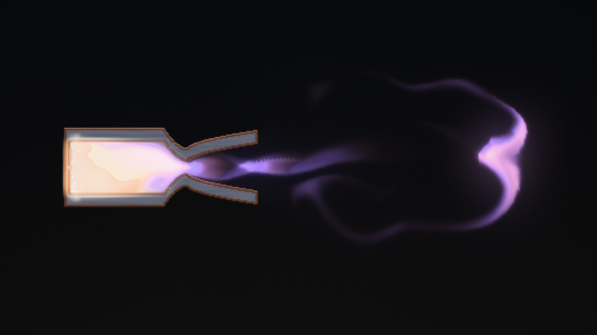
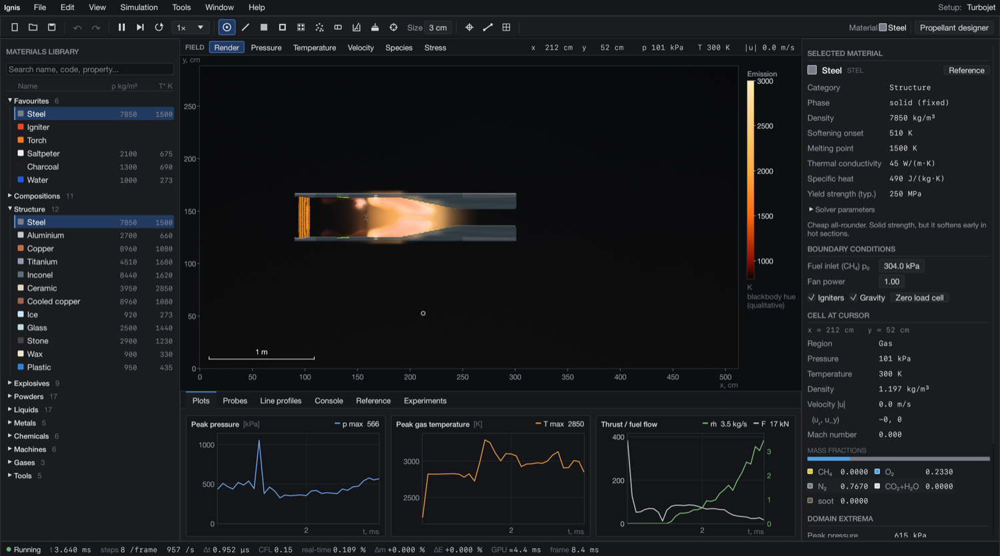
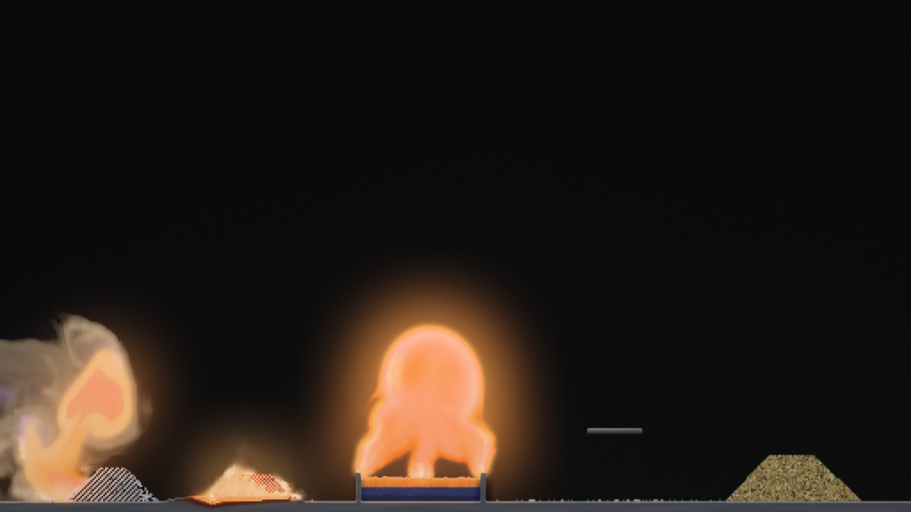
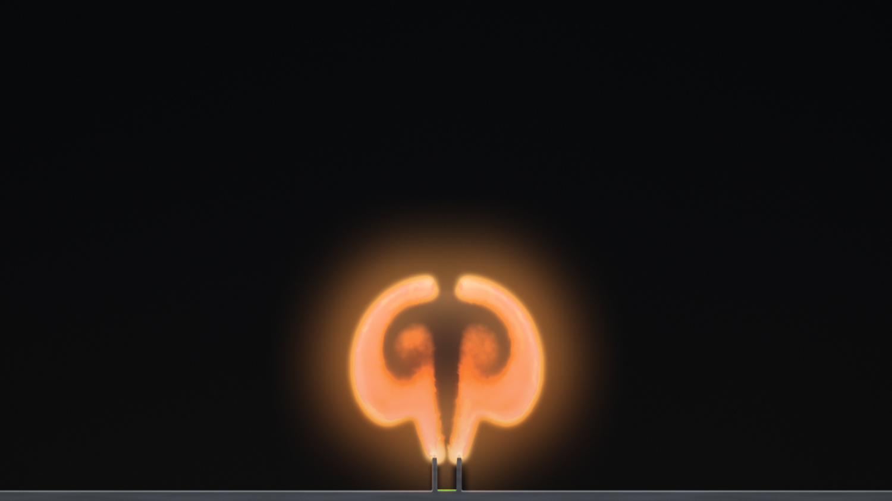
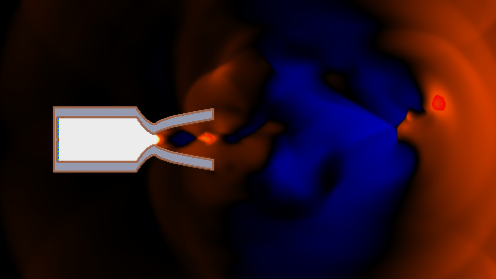

<p align="center">
  
</p>

<p align="center">
  <b>A research-grade 2D combustion and chemistry simulator for macOS.</b><br>
  Compressible reacting gas dynamics on the GPU, powders, liquids and engineering materials, in one interactive workspace.
</p>

<p align="center">
  
  
  
  
  
</p>

<p align="center">
  
</p>

## Overview

Ignis simulates fire, explosions, propulsion and materials chemistry from first principles, then lets you build and break things in a sandbox in the spirit of The Powder Toy, but with a physically based engine underneath and the tooling of a scientific application: probes, plots, field legends, units, and data export.

You can light a methane flare and watch buoyant diffusion flames form, mix saltpeter and charcoal into black powder, burn thermite through a steel plate, fire a methane/oxygen rocket and read its thrust, or design a pressure vessel and find out which wall material fails first.

> **This is an early demo build.** It runs and is usable, but expect rough edges, unfinished features and changing behaviour between releases. See [Known limitations](#known-limitations).

## Download

Get the latest build from the [Releases page](https://github.com/adswill/ignis/releases).

1. Download `Ignis-*-macOS-arm64.dmg` (or the `.zip`).
2. Drag **Ignis** into `Applications`.
3. The app is not signed with an Apple Developer ID, so macOS will warn on first launch. Right-click the app, choose **Open**, then confirm. Alternatively run:

```
xattr -dr com.apple.quarantine /Applications/Ignis.app
```

Requirements: a Mac with Apple Silicon (M1 or newer) and a recent macOS. A modern GPU is required; the simulation runs entirely on it.

## Screenshots

| | |
|---|---|
|  |  |
| The docked scientific workspace: materials library, field legend, probes, plots and inspector. | The chemistry bench: powders, liquids and mixtures reacting. |
|  |  |
| A buoyant methane flare with soot and smoke. | The pressure field of a rocket: shock cells in the exhaust. |

## Features

**Gas dynamics**
- Compressible multi-species Euler solver on the GPU: MUSCL reconstruction, HLLC Riemann solver, two-stage Runge-Kutta, on a 512 by 288 grid.
- Four tracked gas species (fuel, oxygen, nitrogen, combustion products) with per-species heat capacities, so the mixture gamma follows the local composition, plus a soot scalar.
- Smagorinsky large-eddy turbulence model, buoyancy, thermal and species diffusion, wall friction.
- Choked nozzles, shock cells and shock diamonds, blast waves and reflections emerge from the solver.

**Combustion**
- One-step methane oxidation with an Arrhenius rate, combined with a mixing-controlled (eddy-dissipation) rate for diffusion flames.
- Flammability limits, ignition and flame propagation emerge from the chemistry and diffusion.
- Soot formation by pyrolysis in hot, oxygen-starved regions, oxidation, and radiative heat loss.

**Matter and materials**
- More than 50 powders, liquids and solids, simulated as a cellular-automaton layer that falls, piles, flows and floats by density, and is pushed by fast gas.
- Reactions emerge from contact: black powder, rocket candy, thermite, composite propellant, ANFO, liquid-oxygen mixtures, nitroglycerin, boiling with latent heat, melting and solidification.
- A **Mix** tool stirs powders and liquids into an intimate blend, because reaction speed depends on how well components are mixed.
- Wall materials (steel, aluminium, copper, titanium, Inconel, ceramic, cooled copper, wood, and more) with heat transfer, conduction, radiation, softening, bursting under pressure difference and thickness, thermal shock, and melting.

**Workspace**
- Docked layout: searchable materials library with property columns, inspector with SI units, plots, probes, line samplers, console, reference and experiments.
- Scientific views: rendered, pressure, temperature, velocity, species and stress, with numeric colour-map legends.
- Undo and redo, save and open designs, an in-app encyclopedia of materials and concepts, a guided tour, settings, and a library of example setups.
- Procedural audio synthesised from the simulation state.

## Controls

| Action | Input |
|---|---|
| Paint | Left drag |
| Erase | Right drag, or `E` |
| Brush, line, box, frame, fill, spray | `B`, `L`, `X`, `F`, `G`, `S` |
| Brush size | `[` and `]`, or **Shift + scroll** |
| Mix / stir | `M` |
| Zoom | Pinch, or `Cmd` + scroll |
| Pan (when zoomed) | Scroll, or middle drag |
| Pause, single step | `Space`, `.` |
| Views | `1` to `6` |
| Rotate fan | `R` |
| Toggle igniters | `I` |
| Undo, redo | `Cmd+Z`, `Shift+Cmd+Z` |
| Save, open design | `Cmd+S`, `Cmd+O` |

All shortcuts can be changed in the settings.

## Recipes

Reactions are not scripted per recipe: they follow from which substances touch and how hot they are. Some starting points:

| Mixture | Behaviour |
|---|---|
| Saltpeter + charcoal (+ sulfur), stirred | Black powder: fast deflagration with smoke |
| Saltpeter + sugar, stirred | Rocket candy: steady burning |
| Ammonium perchlorate + aluminium | Composite propellant, burns faster under pressure |
| Iron oxide + aluminium | Thermite: hard to ignite, produces molten iron |
| Ammonium nitrate + kerosene | ANFO: smoulders unless struck by a strong shock |
| Liquid oxygen + charcoal | Oxyliquit: violent |
| Water on a hot surface | Boils with latent heat, cooling it |
| Kerosene | Floats on water, vapour burns as a pool fire |

## Physics model

Ignis evolves, on the GPU, density of four gas species, momentum, total energy and a soot density per cell. A reduced speed of sound is used so that low-speed phenomena (flames, buoyant plumes, mixing) evolve at watchable rates while pressure waves, choking and shocks are still resolved. Walls and matter are coupled to the gas through heat exchange and momentum. Heat release, activation energy and heat capacities are calibrated against reference values (for example the adiabatic flame temperature of stoichiometric methane in air). Units: 1 cell is about 1 cm; ambient air is 1 atm and 300 K.

See [docs/ARCHITECTURE.md](docs/ARCHITECTURE.md) for data layouts, the pass order, and the shader map.

## Build from source

Requirements: macOS on Apple Silicon, Xcode command-line tools, and a recent stable Rust toolchain.

```
git clone https://github.com/adswill/ignis.git
cd ignis
cargo run --release
```

Headless benchmark of a scene:

```
./target/release/ignis --bench 600 rocket out.ppm
```

Build the application bundle and disk image:

```
tools/release_macos.sh
```

## Project structure

| Path | Contents |
|---|---|
| `src/sim.wgsl` | Gas solver, combustion, soot, walls |
| `src/matter.wgsl` | Powders and liquids: movement and reactions |
| `src/vis.wgsl`, `render.wgsl`, `fx.wgsl`, `particles.wgsl` | Rendering |
| `src/gpu.rs` | GPU buffers, pipelines and per-frame scheduling |
| `src/app.rs`, `src/ui/` | Application and workspace UI |
| `src/elements.rs` | Element and recipe database |
| `src/audio.rs`, `src/acoustics.rs` | Sound |
| `assets/` | Branding and encyclopedia entries |
| `tools/` | Bundling and QA scripts |

## Known limitations

- Apple Silicon macOS only; no Windows or Linux build yet.
- The gas model has one generic fuel species; hydrogen, kerosene and propane as distinct gases are planned.
- The simulation is two-dimensional and the chemistry is simplified (single-step).
- Performance depends on the GPU and the scene; heavy scenes run slower than real time.
- Visual quality of some effects is still being tuned.

## Licence

Ignis is **source-available** under the [PolyForm Noncommercial License 1.0.0](LICENSE). You may use, study and modify it for personal, educational, research and non-profit purposes. Commercial use is not permitted. For commercial licensing, contact the author through [github.com/adswill](https://github.com/adswill).

## Support

To support more projects, consider donating here: https://ko-fi.com/adswill

## Acknowledgements

Numerical methods: HLLC Riemann solver (Toro), MUSCL reconstruction, Smagorinsky subgrid model, the Eddy Dissipation Concept (Magnussen). The Powder Toy was the inspiration for the sandbox idea.
